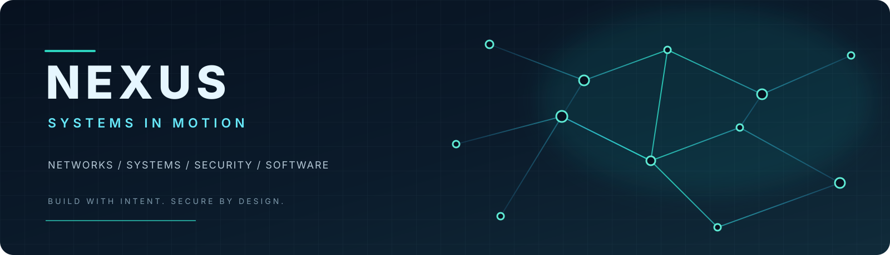

<!-- NEXUS / SYSTEMS IN MOTION -->

### BUILD WITH INTENT. SECURE BY DESIGN. IMPROVE ALWAYS.

**State Engineering Student · Networks, Systems & Security · Full-Stack Development**

Casablanca, Morocco · **PFE internship: February 2027 · 6 months**

[Portfolio](https://houssamessaki.vercel.app/) · [LinkedIn](https://www.linkedin.com/in/houssam-essaki/) · [GitHub](https://github.com/HoussamEssaki) · [ResearchGate](https://www.researchgate.net/profile/Houssam-Essaki)

---

## 00 / THE ENGINEER

I’m a final-year State Engineering student at **Groupe ISGA**, specializing in **Networks, Systems & Security Engineering**.

I’m interested in the engineering behind dependable digital services: the infrastructure that connects them, the systems that operate them, the security controls that protect them, and the software that makes them useful.

My academic and internship work brings together infrastructure engineering, virtualization, network technologies, security, automation and full-stack development. I value clear architecture, reproducible documentation and honest technical validation.

> I build, connect and secure the systems behind digital experiences.

---

## 01 / ENGINEERING DOMAINS

| DOMAIN | PRACTICE & INTERESTS |
|:--|:--|
| **NETWORKS** | TCP/IP, switching, VLANs, 802.1Q, routing, redundancy, VPNs and troubleshooting |
| **SYSTEMS & VIRTUALIZATION** | Linux, Windows environments, VMware, infrastructure services and administration |
| **SECURITY** | Network security, Fortinet environments, hardening, access control and defensive monitoring |
| **CLOUD & DEVOPS** | Cloud fundamentals, hybrid infrastructure concepts, Docker and automation |
| **SOFTWARE ENGINEERING** | Python, JavaScript/TypeScript, Django REST Framework, React, SQL and API integration |
| **OBSERVABILITY** | Monitoring, logs, dashboards, alerting and workflow automation |

*These are areas of study and practice, not a claim of expert-level proficiency in every technology.*

---

## 02 / SELECTED BUILDS

### 01 — Enterprise Infrastructure & Security Lab
**Infrastructure · Network Design · Security · Monitoring**

A structured, isolated lab project for designing and validating an enterprise-style environment.

- Segmented user, server, DMZ and management zones.
- Virtualization and core infrastructure services.
- Defensive security controls and restricted administration.
- Monitoring, logging, backup and recovery planning.
- A status register that separates planned, implemented and tested work.

[OPEN THE LAB →](https://github.com/HoussamEssaki/enterprise-infrastructure-security-lab)

### 02 — JOBGATE Appointment System
**Full-Stack · Django REST · React · PostgreSQL**

A university/startup-oriented appointment and talent-management application developed during an internship project.

- Backend based on Django REST Framework and PostgreSQL.
- Frontend based on React and TypeScript.
- Project work also involved Redis, Celery, Docker, JWT and API integration.
- Role-oriented workflows for platform actors.

[EXPLORE JOBGATE →](https://github.com/HoussamEssaki/JOBGATE_Appointment_System)

### 03 — Personal Journal & Mood Tracker
**Android · Kotlin · Local Data · Privacy-Aware Design**

An Android application project focused on personal journaling, offline-first use and privacy-conscious local data handling.

[EXPLORE THE PROJECT →](https://github.com/HoussamEssaki/Personal-Journal-and-Mood-Tracker)

### 04 — University Management Console
**C++ · Object-Oriented Programming**

A console-based academic project exploring object-oriented application structure and university-management workflows.

[EXPLORE THE PROJECT →](https://github.com/HoussamEssaki/Application-console-de-gestion-universitaire)

### 05 — Line-Following & Obstacle-Detection Robot
**Embedded Systems · Robotics · Bluetooth Control**

A student robotics project combining line-following, obstacle-detection and Bluetooth-control objectives.

[EXPLORE THE PROJECT →](https://github.com/HoussamEssaki/ROBOT-VOITURE-SUIVEUR-DE-LIGNE-ET-DETECTEUR-D-OBSTACLE-AVEC-CONTROLE-BLUETOOTH)

### 06 — IT Equipment E-Commerce
**Web Development · Academic Project**

An academic project centered on an online IT-equipment sales experience.

[EXPLORE THE PROJECT →](https://github.com/HoussamEssaki/Vente-de-Mat-riel-Informatique)

---

## 03 / ENGINEERING NOTEBOOK

I believe technical work should remain understandable after the original builder leaves the room.

My documentation approach is built around five questions:

- **Architecture** — What are the components, boundaries and dependencies?
- **Configuration intent** — Why does each control exist?
- **Validation** — What was tested, what passed and what remains unverified?
- **Security** — Where are the trust boundaries, access paths and residual risks?
- **Operations** — How are monitoring, backup and recovery handled?

The infrastructure lab is where I’m developing this practice through structured design notes and a validation register.

---

## 04 / TOOLBOX

**NETWORK & INFRASTRUCTURE**

**DEVELOPMENT & AUTOMATION**

**SECURITY & OBSERVABILITY**

---

## 05 / CURRENT TRANSMISSION

**Primary objective:** a **six-month PFE internship starting February 2027** in Morocco.

Areas I’m particularly interested in:

- Network and systems engineering
- Infrastructure and network security
- Security monitoring and operational resilience
- Virtualization, hybrid cloud and automation
- DevOps and the intersection of software and infrastructure

---

## 06 / CONNECT

### LET’S BUILD SOMETHING THAT WORKS — AND THAT CAN BE TRUSTED.

NEXUS / SYSTEMS IN MOTION · Houssam Essaki · 2026

