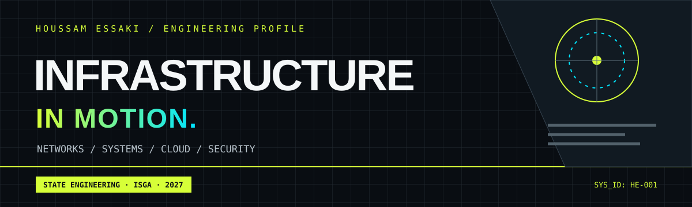
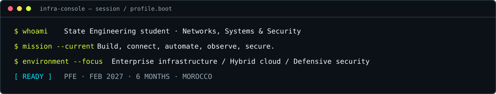
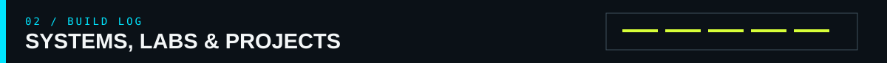
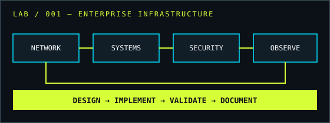
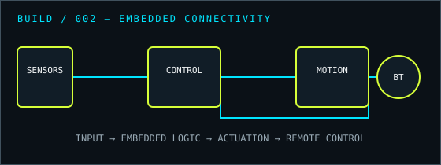
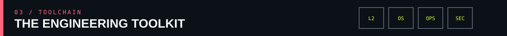
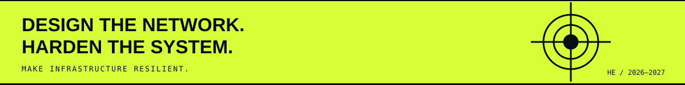

 

  

 

## 00 / OPERATOR PROFILE

**Final-year State Engineering student at Groupe ISGA**  
**Networks, Systems & Security Engineering** · Morocco

I focus on the foundations that keep digital services dependable: enterprise connectivity, system administration, virtualization, infrastructure automation, observability and defensive security.

I’m interested in how infrastructure behaves as a whole — how networks connect services, how systems recover, how operations become measurable, and how security is built into the architecture rather than added at the end.

<b>MORE ABOUT MY ENGINEERING DIRECTION</b>

 

- **Infrastructure:** enterprise networks, Linux / Windows environments, virtualization and hybrid infrastructure.
- **Operations:** scripting, repeatable administration, monitoring, metrics, logs and alerting.
- **Security:** network defence, firewall concepts, hardening, security monitoring and resilience.
- **Next frontier:** Cloud, DevOps / DevSecOps, infrastructure-as-code and incident response.

---

### UNION IT SERVICES / INFRASTRUCTURE PFA

JULY — AUGUST 2026 · MOROCCO

Exposure to a multi-site, virtualized and hybrid enterprise infrastructure environment.

| ENGINEERING AREA | FIELD CONTEXT |
|:--|:--|
| **Network switching** | Cisco VLANs, 802.1Q, Rapid-PVST, HSRP, LACP / EtherChannel |
| **Network security** | FortiGate firewalling and Active-Passive high-availability concepts |
| **Virtualization** | VMware-based infrastructure and virtualized environments |
| **Engineering perspective** | Connectivity, segmentation, availability and security considered together |

Published as a professional learning summary. No confidential configurations, addresses or operational details are disclosed.

---

<table>
<tr>
<td width="50%" valign="top">

### 01 / ENTERPRISE INFRASTRUCTURE & SECURITY LAB

A documented enterprise-style lab blueprint exploring segmented networks, systems, virtualization, defensive controls, observability, backup and recovery.

**FOCUS**  
Architecture · Networks · Systems · Security

**STATUS**  
Design baseline and documentation. Implementation and validation are tracked separately.

</td>
<td width="50%" valign="top">

### 02 / EMBEDDED SYSTEMS & CONNECTIVITY

Academic robotics project combining embedded control, sensor-driven behaviour and Bluetooth communication.

**FOCUS**  
Embedded · IoT · Connectivity

**CONTEXT**  
Academic project work.

</td>
</tr>
<tr>
<td width="50%" valign="top">

### 03 / JOBGATE — APPOINTMENT SYSTEM

University appointment workflows and role-based user journeys, built as an academic software project.

</td>
<td width="50%" valign="top">

### 04 / ACADEMIC PROJECT COLLECTION

A collection of supervised academic projects, including work around AI and e-commerce themes.

</td>
</tr>
</table>

**MORE BUILDS:** [University Management Console (C++)](https://github.com/HoussamEssaki/Application-console-de-gestion-universitaire) · [IT Equipment Store](https://github.com/HoussamEssaki/Vente-de-Mat-riel-Informatique) · [All repositories ↗](https://github.com/HoussamEssaki?tab=repositories)

---

**NETWORKING**  
     

---

**SYSTEMS & VIRTUALIZATION**  
     

---

**NETWORK & SYSTEM SECURITY**  
     

---

**AUTOMATION & OBSERVABILITY**  
      

---

**CLOUD & INFRASTRUCTURE**  
   

---

**DEVELOPMENT & APIs**  
       

---

**DATA & MESSAGING**  
     

---

**AI & WORKFLOW AUTOMATION**  
  

---

**IOT & EMBEDDED SYSTEMS**  
  

SKILL CONTEXT: technologies reflect a mix of hands-on practice, internship exposure, academic projects and ongoing learning. Logos identify tools and ecosystems; they do not imply equal proficiency or production-level expertise.

---

## 04 / CURRENT LEARNING VECTOR

| NOW | BUILDING TOWARDS |
|:--|:--|
| Enterprise networking & troubleshooting | Resilient multi-site infrastructure |
| Linux administration & scripting | Infrastructure automation |
| Monitoring & operational visibility | Observability-driven operations |
| Defensive security fundamentals | Security monitoring & incident response |
| Virtualization & hybrid environments | Cloud / DevOps / DevSecOps foundations |

---

## 05 / NEXT DEPLOYMENT

CAREER OBJECTIVE · FEBRUARY 2027

I’m seeking a **six-month PFE internship** in Morocco, starting **February 2027**, in one of these areas:

**NETWORKS** · **SYSTEMS** · **INFRASTRUCTURE** · **CLOUD** · **IT OPERATIONS** · **CYBERSECURITY**

I’m looking for an environment where I can contribute to real infrastructure work, learn from experienced engineers and turn sound technical foundations into reliable operational outcomes.

---

## 06 / GITHUB TELEMETRY

 

 

 

<picture>
  <source media="(prefers-color-scheme: dark)" srcset="https://raw.githubusercontent.com/HoussamEssaki/HoussamEssaki/output/github-contribution-grid-snake-dark.svg" />
  <source media="(prefers-color-scheme: light)" srcset="https://raw.githubusercontent.com/HoussamEssaki/HoussamEssaki/output/github-contribution-grid-snake.svg" />
  
</picture>

 

Telemetry widgets are provided by external services; availability and refresh timing may vary.

---

## 07 / CONNECT

  

HOUSSAM ESSAKI · NETWORKS / SYSTEMS / INFRASTRUCTURE / SECURITY · 2026–2027

