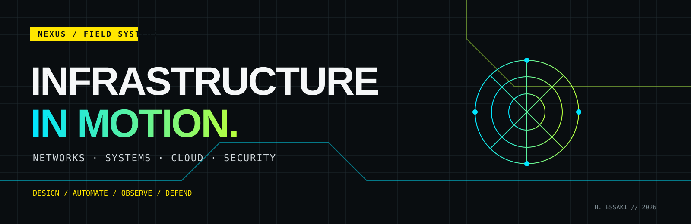
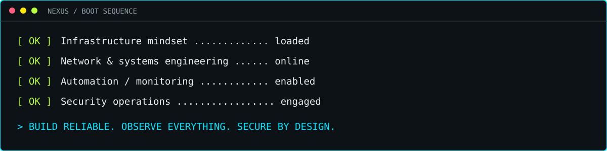
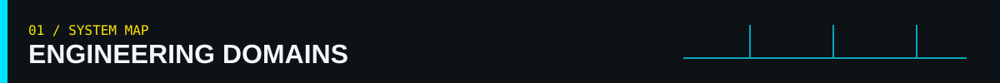
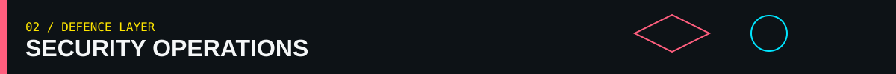
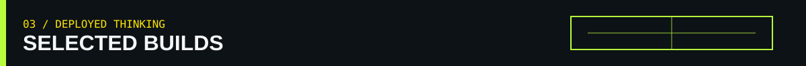
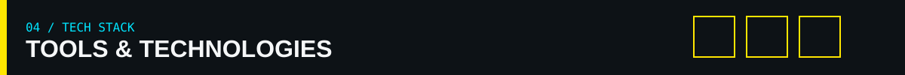
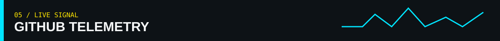

  
  
    
  
  
  
  
    
  
  
  

  

> **NEXUS PRINCIPLE //** Reliable infrastructure is engineered. Visibility is intentional. Security is continuous.

---

## SYSTEM PROFILE

I’m a final-year State Engineering student at **Groupe ISGA**, specializing in **Networks, Systems & Security Engineering**.

My focus is the engineering, operation, automation, monitoring and protection of enterprise IT environments. I’m particularly interested in the intersection of infrastructure engineering and cybersecurity: resilient networks, observable systems, governed cloud environments and security built into operations.

**MISSION:** connect infrastructure, operational excellence and security engineering.

| ENGINEERING PILLAR | AREAS OF FOCUS | CORE TECHNOLOGIES |
|:--|:--|:--|
| **01 / NETWORKS** | Routing, switching, segmentation, WAN, high availability | Cisco, VLAN, 802.1Q, STP, OSPF, HSRP, LACP, VPN |
| **02 / SYSTEMS** | Linux & Windows administration, identity, services, hardening | Debian, Ubuntu, Windows Server, AD DS, DNS, DHCP, GPO |
| **03 / VIRTUALIZATION** | Hypervisors, virtual networks, compute and storage | VMware ESXi, vSphere, vCenter, Hyper-V, Proxmox |
| **04 / AUTOMATION** | Scripting, configuration management, repeatable operations | Python, Bash, PowerShell, Ansible, Terraform, n8n |
| **05 / OBSERVABILITY** | Metrics, logs, dashboards, alerting and service health | Zabbix, Prometheus, Grafana, Netdata, ELK, OpenSearch |
| **06 / CLOUD & DEVOPS** | Hybrid environments, containers, CI/CD and IaC | Azure, AWS, Docker, Kubernetes, GitHub Actions |
| **07 / CYBERSECURITY** | SOC, security assessment, GRC, IAM and infrastructure defence | Wazuh, SIEM, ISO 27001, Entra ID, RBAC |
| **08 / AI SECURITY** | Security analytics, anomaly detection and IoT security concepts | Python, scikit-learn, TensorFlow, TinyML, ESP32 |

---

## SECURITY OPERATIONS / SPECIALIZATION MAP

<table>
<tr>
<td width="50%" valign="top">

### 01 — SOC / BLUE TEAM
Security monitoring, log analysis, alert qualification, event correlation, incident handling, threat intelligence, detection fundamentals and MITRE ATT&CK.

**TOOLS & CONCEPTS:** Wazuh · Splunk · Microsoft Sentinel · Defender · SIEM · EDR/XDR concepts

</td>
<td width="50%" valign="top">

### 02 — SECURITY ASSESSMENT
Authorized assessment methodology, scope definition, asset discovery, vulnerability assessment, network and web security fundamentals, remediation and reporting.

**TOOLS & CONCEPTS:** Nmap · Wireshark · Nessus · Burp Suite · OWASP ZAP · OWASP Top 10

</td>
</tr>
<tr>
<td width="50%" valign="top">

### 03 — GRC / RISK
Information security management, risk assessment, security policies, control mapping, audit preparation, compliance evidence and remediation tracking.

**FRAMEWORKS:** ISO/IEC 27001 · NIST CSF · ISMS · Risk Register · Security Controls

</td>
<td width="50%" valign="top">

### 04 — IAM / ACCESS GOVERNANCE
Identity lifecycle, authentication, authorization, access reviews, role-based access, least privilege, MFA, SSO and privileged-access concepts.

**TECHNOLOGIES:** Active Directory · Entra ID · RBAC · MFA · SSO · PAM concepts

</td>
</tr>
<tr>
<td width="50%" valign="top">

### 05 — CLOUD & DEVSECOPS
Cloud shared responsibility, secure identity and configuration, workload protection, container security fundamentals, secrets handling and security checks in CI/CD.

**TECHNOLOGIES:** Azure · AWS · Docker · Kubernetes · Terraform · GitHub Actions

</td>
<td width="50%" valign="top">

### 06 — AI FOR SECURITY
Machine-learning fundamentals for anomaly detection, event analysis, IoT security and responsible AI-assisted security workflows.

**TECHNOLOGIES:** Python · NumPy · Pandas · scikit-learn · TensorFlow · TinyML

</td>
</tr>
</table>

---

## SELECTED BUILDS / ENGINEERING WORK

<table>
<tr>
<td width="50%" valign="top">

### Enterprise Infrastructure & Security Lab

Enterprise-style lab documentation covering network architecture, segmentation, virtualization, defensive controls, monitoring and resilience.

**SCOPE:** Networking · Virtualization · Security · Monitoring

[EXPLORE THE LAB ↗](https://github.com/HoussamEssaki/enterprise-infrastructure-security-lab)

</td>
<td width="50%" valign="top">

### Multi-site Infrastructure & Security

Industry placement exposure to enterprise network and virtualized infrastructure, high-availability concepts, firewall services and operational monitoring.

**SCOPE:** Cisco · FortiGate HA · VMware · Resilience

Public descriptions are generalized; confidential employer configurations are excluded.

</td>
</tr>
<tr>
<td width="50%" valign="top">

### Linux Monitoring & Automation

Linux server monitoring environment with metrics, dashboards, notifications and workflow automation.

**SCOPE:** Debian · Netdata · Node Exporter · Glances · n8n

</td>
<td width="50%" valign="top">

### AI-assisted IoT Study

Academic exploration of connected-device systems, embedded platforms and machine-learning concepts for local anomaly detection.

**SCOPE:** ESP32 · IoT · TinyML concepts · Machine Learning

</td>
</tr>
</table>

---

## TECHNICAL ECOSYSTEM / TOOLBOX

<b>NETWORK ENGINEERING & CONNECTIVITY</b>

 
Cisco · Packet Tracer · GNS3 · EVE-NG · PNETLab · Wireshark · tcpdump · PuTTY · MobaXterm · Termius · FortiGate · pfSense · IPv4/IPv6 · TCP/IP · VLAN · 802.1Q · STP · Rapid-PVST+ · EtherChannel · LACP · OSPF · HSRP · NAT/PAT · ACL · VPN · WAN · SDN · SD-WAN

<b>SYSTEMS, DIRECTORY SERVICES & VIRTUALIZATION</b>

 
Linux · Debian · Ubuntu · RHEL fundamentals · Windows Server · Active Directory · AD DS · DNS · DHCP · GPO · WSUS · PowerShell · Bash · VMware Workstation · ESXi · vSphere · vCenter · Hyper-V · Proxmox · VirtualBox

<b>AUTOMATION, DEVOPS & INFRASTRUCTURE AS CODE</b>

 
Python · Bash · PowerShell · Ansible · Terraform · Git · GitHub Actions · Docker · Docker Compose · Kubernetes fundamentals · CI/CD concepts · n8n · Configuration Management · Infrastructure as Code

<b>MONITORING, LOGGING & OBSERVABILITY</b>

 
Zabbix · Prometheus · Grafana · Netdata · Node Exporter · Glances · ELK Stack · OpenSearch · Centralized Logging · Alerting · Dashboards · Metrics

<b>CYBERSECURITY, SOC & SECURITY ASSESSMENT</b>

 
Wazuh · Splunk · Microsoft Sentinel · Microsoft Defender · Nessus · Nmap · Kali Linux · Burp Suite · OWASP ZAP · Wireshark · MITRE ATT&CK · SIEM · IDS/IPS concepts · Vulnerability Management · Incident Response

<b>CLOUD, IAM, GRC & AI SECURITY</b>

 
Microsoft Azure · Microsoft Entra ID · Azure RBAC · AWS fundamentals · GCP fundamentals · IAM · RBAC · MFA · SSO · ISO/IEC 27001 · NIST CSF · Risk Assessment · ISMS · Python · NumPy · Pandas · scikit-learn · TensorFlow · PyTorch fundamentals · TensorFlow Lite Micro · ESP32

Technology map: a mix of hands-on practice, academic exposure and current learning priorities. It does not imply expert-level proficiency in every listed product or framework.

---

## GITHUB TELEMETRY

  
  
    
  
    
  <picture>
    <source media="(prefers-color-scheme: dark)" srcset="https://raw.githubusercontent.com/HoussamEssaki/HoussamEssaki/output/github-contribution-grid-snake-dark.svg"/>
    <source media="(prefers-color-scheme: light)" srcset="https://raw.githubusercontent.com/HoussamEssaki/HoussamEssaki/output/github-contribution-grid-snake.svg"/>
    
  </picture>

---

## CURRENT TRANSMISSION

**Seeking a six-month PFE internship starting February 2027 in Morocco.**

- Infrastructure, networks and systems engineering
- Virtualization, datacentres and hybrid cloud
- Network and infrastructure security
- SOC, SIEM, monitoring and incident response
- Security assessment and vulnerability management
- GRC, ISO 27001 and risk management
- IAM and access governance
- Automation, observability, DevOps and DevSecOps
- AI applied to infrastructure and cybersecurity

  
  <h3>DESIGN RELIABLE INFRASTRUCTURE. MAKE IT OBSERVABLE. SECURE IT THROUGHOUT ITS LIFECYCLE.</h3>
  <a href="https://houssamessaki.vercel.app/">PORTFOLIO</a> ·
  <a href="https://www.linkedin.com/in/houssam-essaki/">LINKEDIN</a> ·
  <a href="https://tryhackme.com/p/houssamessaki">TRYHACKME</a> ·
  <a href="https://github.com/HoussamEssaki">GITHUB</a>
    
  NEXUS // INFRASTRUCTURE CONTROL SYSTEM · HOUSSAM ESSAKI · 2026

