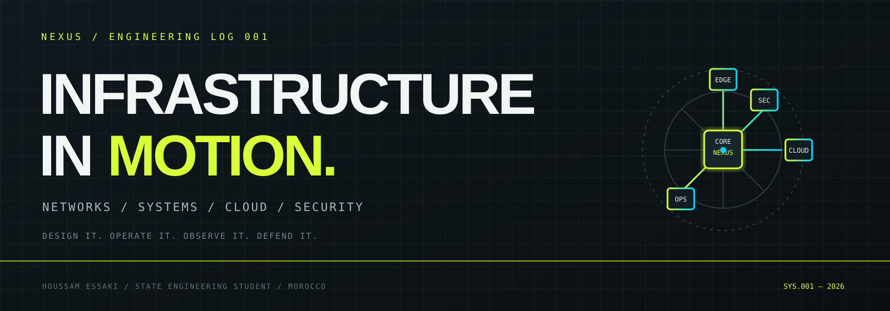
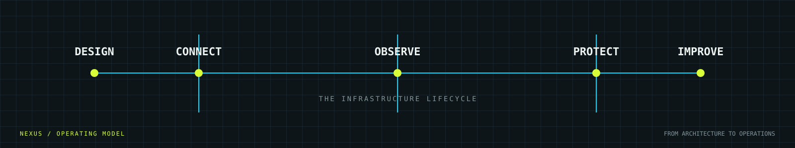

 

 

> **ENGINEERING NOTE 001** — I’m interested in the systems behind reliable digital services: how infrastructure is designed, connected, automated, monitored and secured.

## 00 / WHO I AM

I’m a final-year State Engineering student at **Groupe ISGA**, specializing in **Networks, Systems & Security Engineering**.

My direction is infrastructure-first: enterprise networks, Linux and Windows environments, virtualization, hybrid infrastructure, automation and defensive security. I like understanding how the layers fit together — from connectivity and identity to observability, resilience and security controls.

**Current objective:** a six-month PFE internship in Morocco starting **February 2027**, focused on Networks, Systems, Infrastructure, Cloud or Cybersecurity.

CASABLANCA, MOROCCO · STATE ENGINEERING · CLASS OF 2027

---

## 01 / ENGINEERING DOMAINS

<table>
<tr>
<td width="50%" valign="top">

### 01 — NETWORKS & CONNECTIVITY

- Switching, VLAN segmentation and trunking
- Layer 2 resilience and gateway high availability
- Routing fundamentals, WAN and VPN concepts
- Network troubleshooting and packet analysis

WORKING CONTEXT · Cisco · VLAN · 802.1Q · Rapid-PVST · HSRP · LACP · Wireshark

</td>
<td width="50%" valign="top">

### 02 — SYSTEMS & VIRTUALIZATION

- Linux administration and service management
- Windows Server and directory-service concepts
- Virtual machines and virtual infrastructure
- Core services, access control and hardening

WORKING CONTEXT · Debian · Linux · Windows Server · VMware ESXi / vCenter

</td>
</tr>
<tr>
<td width="50%" valign="top">

### 03 — AUTOMATION & OBSERVABILITY

- Scripting for repeatable administration
- Infrastructure and service monitoring
- Metrics, logs, dashboards and alerting
- Workflow automation and operational visibility

WORKING CONTEXT · Python · Bash · PowerShell · Netdata · Node Exporter · Glances · n8n

</td>
<td width="50%" valign="top">

### 04 — SECURITY & RESILIENCE

- Network and infrastructure defence
- Firewall policy and security services
- Security monitoring and incident fundamentals
- Backup, recovery, risk and access governance

LEARNING PATH · FortiGate · SIEM concepts · ISO/IEC 27001 · IAM · Incident Response

</td>
</tr>
</table>

---

## 02 / FIELD EXPERIENCE

### UNION IT SERVICES — Infrastructure PFA
**July – August 2026 · Morocco**

Exposure to enterprise infrastructure engineering in a multi-site, virtualized and hybrid environment.

- Worked around Cisco switching: VLANs, 802.1Q, Rapid-PVST, HSRP and LACP / EtherChannel.
- Worked with FortiGate firewalling and high-availability concepts.
- Gained exposure to VMware-based infrastructure and operational resilience.
- Connected network design, infrastructure services and security considerations.

Professional experience summary. No employer-confidential configurations, addresses or operational details are published here.

---

## 03 / FLAGSHIP WORK

<table>
<tr>
<td width="50%" valign="top">

### ENTERPRISE INFRASTRUCTURE & SECURITY LAB

A documented enterprise-style learning environment covering network segmentation, systems, virtualization, defensive controls, monitoring and recovery.

**FOCUS** · Architecture / Infrastructure / Security

**STATUS** · Design baseline and documentation; implementation and validation tracked separately.

[EXPLORE THE LAB ↗](https://github.com/HoussamEssaki/enterprise-infrastructure-security-lab)

</td>
<td width="50%" valign="top">

### EMBEDDED SYSTEMS & CONNECTIVITY

Academic robotics project combining embedded control, sensor-driven behaviour and Bluetooth communication.

**FOCUS** · Embedded / IoT / Connectivity

[EXPLORE THE PROJECT ↗](https://github.com/HoussamEssaki/ROBOT-VOITURE-SUIVEUR-DE-LIGNE-ET-DETECTEUR-D-OBSTACLE-AVEC-CONTROLE-BLUETOOTH/tree/Robot_Voiture)

</td>
</tr>
</table>

### OTHER ACADEMIC BUILDS

- [JOBGATE — Appointment System](https://github.com/HoussamEssaki/JOBGATE_Appointment_System) · University appointment workflows and role-based user journeys.
- [AI × E-commerce projects](https://github.com/HoussamEssaki/Realisation_de_projets_tuteures) · Academic work involving recommendation and computer-vision themes.
- [University Management Console](https://github.com/HoussamEssaki/Application-console-de-gestion-universitaire) · C++ and object-oriented programming.
- [IT Equipment Store](https://github.com/HoussamEssaki/Vente-de-Mat-riel-Informatique) · Academic e-commerce project.

[ BROWSE ALL REPOSITORIES ↗ ](https://github.com/HoussamEssaki?tab=repositories)

---

## 04 / TOOLKIT

| AREA | HANDS-ON / ACADEMIC CONTEXT |
|:--|:--|
| **Networking** | Cisco switching, VLANs, 802.1Q, STP, HSRP, LACP, Wireshark |
| **Systems** | Debian, Linux, Windows Server, VMware |
| **Automation** | Python, Bash, PowerShell, n8n |
| **Monitoring** | Netdata, Node Exporter, Glances, service and host telemetry |
| **Security** | FortiGate exposure, firewall concepts, security monitoring fundamentals |
| **Data & services** | MariaDB, Kafka coursework, Docker and service integration |

Accuracy rule: this list reflects a mixture of practical work, academic projects and learning. It is not a claim of expert-level proficiency in every technology.

## 05 / CURRENT LEARNING VECTOR

- Building stronger foundations in enterprise network and systems engineering.
- Improving Linux administration, automation and infrastructure observability.
- Developing defensive security knowledge: monitoring, incident handling, hardening and risk.
- Exploring Cloud, DevOps / DevSecOps and infrastructure-as-code practices.

---

## 06 / LET'S CONNECT

**Open to:** PFE opportunities beginning February 2027 in Networks, Systems, Infrastructure, Cloud, IT Operations or Cybersecurity.

### DESIGN THE INFRASTRUCTURE.
### MAKE OPERATIONS VISIBLE.
### BUILD SECURITY INTO THE SYSTEM.

[PORTFOLIO](https://houssamessaki.vercel.app/) &nbsp;·&nbsp; [LINKEDIN](https://www.linkedin.com/in/houssam-essaki/) &nbsp;·&nbsp; [TRYHACKME](https://tryhackme.com/p/houssamessaki)

NEXUS / HOUSSAM ESSAKI / INFRASTRUCTURE ENGINEERING / 2026–2027

